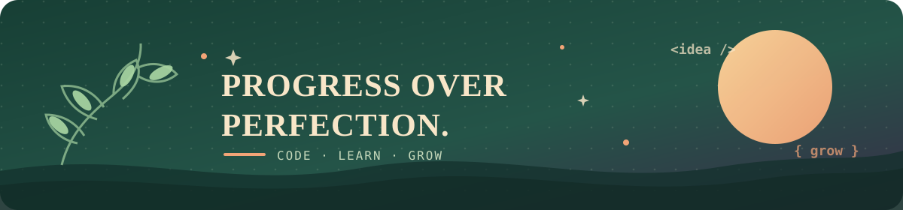

# SYEDA KHADIJA HASSAN

BS Software Engineering, UAJK · Muzaffarabad, AJK

  

---

I'm a fifth-semester software engineering student at UAJK. I turn course concepts into projects that actually run, mostly in Python, with some C++ and far too many notebooks.

  

Currently exploring Machine Learning and Python fundamentals.

---

<table>
  <tr>
    <td width="50%" valign="top">
      <h3>Machine Learning Lab</h3>
      Data cleaning, exploratory analysis and linear regression in Jupyter.  
      
      
      
        
      <a href="https://github.com/hassankhadija06/ML-Lab-2024SE09">View repo</a>
    </td>
    <td width="50%" valign="top">
      <h3>Digital Image Processing</h3>
      Histograms, thresholding, convolution and noise filtering.  
      
      
        
      <a href="https://github.com/hassankhadija06/DIP-CS-3112">View repo</a>
    </td>
  </tr>
  <tr>
    <td width="50%" valign="top">
      <h3>Restaurant Ordering System</h3>
      A C++ console app with menus, deals, discounts, payments and invoices, with input validation.  
      
        
      <a href="https://github.com/hassankhadija06/Semester-01-Labs/blob/main/OpenEnded_Lab.cpp">View file</a>
    </td>
    <td width="50%" valign="top">
      <h3>Personal Website</h3>
      Hand-written HTML, CSS and JavaScript, built to learn the basics properly.  
      
      
      
        
      <a href="https://github.com/hassankhadija06/hassankhadija06.github.io">View site</a>
    </td>
  </tr>
</table>

<b>More coursework</b>

 

- [Database-Systems-CS-2204](https://github.com/hassankhadija06/Database-Systems-CS-2204)
- [Computer-Networks](https://github.com/hassankhadija06/Computer-Networks)
- [Semester-02-Labs](https://github.com/hassankhadija06/Semester-02-Labs)
- [Software-Construction-and-Development-SE-3101](https://github.com/hassankhadija06/Software-Construction-and-Development-SE-3101)
- [Webpage-Development](https://github.com/hassankhadija06/Webpage-Development)

---

  
  
  
  
  
  
  
  
  

---

  
  

  

---

 

driven by the fear of being mediocre.

