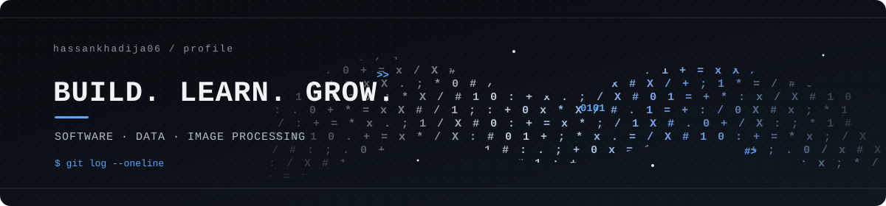
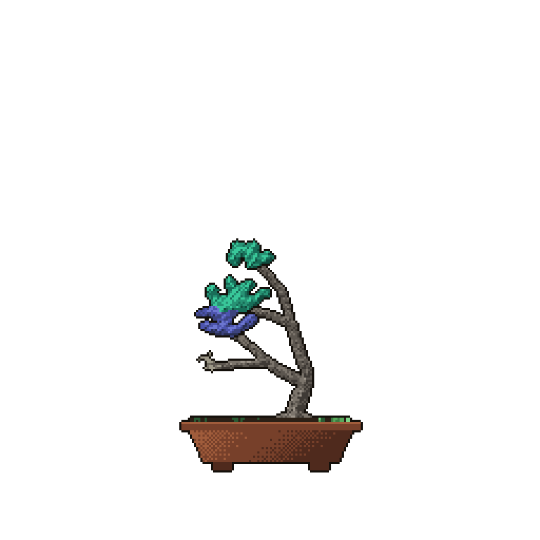

# SYEDA KHADIJA HASSAN

BS Software Engineering · UAJK · Muzaffarabad, AJK

  

---

<table>
  <tr>
    <td>
      <b>01 / ABOUT</b>
        
      I'm a fifth-semester software engineering student at UAJK. I turn course concepts into projects that actually run, mostly in Python, with some C++ and far too many notebooks.
        
      Currently exploring machine learning and Python fundamentals.
    </td>
  </tr>
</table>

  

---

<h2 align="center">02 / PROJECTS</h2>

<table>
  <tr>
    <td width="50%" valign="top">
      <h3>🌱 Machine Learning Lab</h3>
      Data cleaning, exploratory analysis and linear regression in Jupyter.  
      
      
      
        
      <a href="https://github.com/hassankhadija06/ML-Lab-2024SE09"><b>View repo →</b></a>
    </td>
    <td width="50%" valign="top">
      <h3>📷 Digital Image Processing</h3>
      Histograms, thresholding, convolution and noise filtering.  
      
      
        
      <a href="https://github.com/hassankhadija06/DIP-CS-3112"><b>View repo →</b></a>
    </td>
  </tr>
  <tr>
    <td width="50%" valign="top">
      <h3>🍽️ Restaurant Ordering System</h3>
      A C++ console app with menus, deals, discounts, payments and invoices, with input validation.  
      
        
      <a href="https://github.com/hassankhadija06/Semester-01-Labs/blob/main/OpenEnded_Lab.cpp"><b>View file →</b></a>
    </td>
    <td width="50%" valign="top">
      <h3>🌐 Personal Website</h3>
      Hand-written HTML, CSS and JavaScript, built to learn the basics properly.  
      
      
      
        
      <a href="https://github.com/hassankhadija06/hassankhadija06.github.io"><b>View site →</b></a>
    </td>
  </tr>
</table>

<b>🌿 More coursework</b>

 

- [Database Systems](https://github.com/hassankhadija06/Database-Systems-CS-2204)
- [Computer Networks](https://github.com/hassankhadija06/Computer-Networks)
- [Semester 02 Labs](https://github.com/hassankhadija06/Semester-02-Labs)
- [Software Construction and Development](https://github.com/hassankhadija06/Software-Construction-and-Development-SE-3101)
- [Webpage Development](https://github.com/hassankhadija06/Webpage-Development)

---

<h2 align="center">03 / STACK</h2>

  
  
  
  
  
  
  
  
  

---

<h2 align="center">04 / GROWTH</h2>

  
  

  

---

<h2>05 / LET'S CONNECT</h2>

  

<i>driven by the fear of being mediocre</i>

